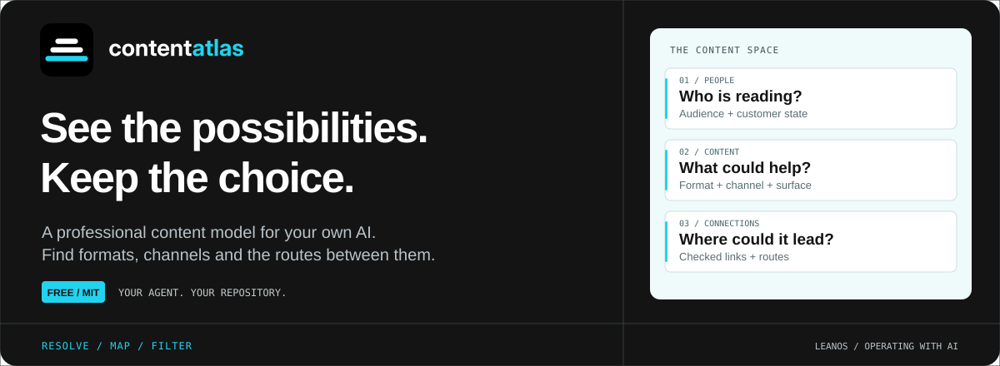

<p align="center">
  
</p>

<h1 align="center">Content with a route.</h1>

<p align="center">
  A professional content model your own AI can read.<br>
  See what could serve your audience, where it could reach them, and how one piece could lead to the next.
</p>

<p align="center">
  <strong>Free under MIT</strong> &nbsp;·&nbsp; 3 skills &nbsp;·&nbsp; Your own coding agent &nbsp;·&nbsp; JSON + Excel
</p>

<p align="center">
  <a href="#start">Start here</a> &nbsp; / &nbsp;
  <a href="#three-ways-in">Explore the skills</a> &nbsp; / &nbsp;
  <a href="#inside-the-atlas">Look inside</a> &nbsp; / &nbsp;
  <a href="https://www.leanos.tech/">LeanOS</a>
</p>

---

## Give your AI the field. Keep the decision.

You know your product. Content Atlas gives your agent the professional vocabulary and relationships to explore how content could help: reader states, audiences, formats, channels, surfaces, recipes and reuse transformations.

Programs enumerate what the declared model holds for your question and check the connections. Your agent explains the possibilities and their conditions. You choose what to make.

## Three ways in

<table>
  <tr>
    <td width="33%" valign="top">
      <h3>01 · Resolve</h3>
      <p><strong>What could we do?</strong></p>
      <p>Bring a question. See the content constructions, links and checked routes the atlas holds for it.</p>
      <a href=".claude/skills/resolve-possibilities/SKILL.md">Read the skill →</a>
    </td>
    <td width="33%" valign="top">
      <h3>02 · Map</h3>
      <p><strong>What do we already have?</strong></p>
      <p>Place existing pieces, inspect their coverage and mismatches, and explore where they could lead.</p>
      <a href=".claude/skills/map-existing-content/SKILL.md">Read the skill →</a>
    </td>
    <td width="33%" valign="top">
      <h3>03 · Filter</h3>
      <p><strong>Show me this part.</strong></p>
      <p>Narrow a finished result by channel, format, ownership, audience or fit. Keep the original result.</p>
      <a href=".claude/skills/filter-possibilities/SKILL.md">Read the skill →</a>
    </td>
  </tr>
</table>

## Start

Bring an agent that reads `.claude/skills` or `.agents/skills`, such as Claude Code, Codex or Cursor, and Python 3.10 or later.

```sh
git clone https://github.com/LeanOS-Technologies/content-atlas.git
cd content-atlas
python3 -m venv .venv
. .venv/bin/activate
python -m pip install openpyxl
```

Open your coding agent in the cloned folder and ask:

> Read AGENTS.md. Our buyers are comparing us with two competitors. What content could help them decide?

Or start from what you already have:

> We publish a blog, a newsletter and case studies. Map what they cover and where they could lead.

<!-- Presentation-only files -->

> [!TIP]
> **Delete this README after cloning.** It is the GitHub marketing page, not part of the Content Atlas model. You can also delete `.github/readme/`, which contains only this page's artwork. Your agent starts at [AGENTS.md](AGENTS.md); [PROFILE.md](PROFILE.md) explains the capability. Keep [LICENSE](LICENSE).

## A result you can inspect and reuse

| File | What you get |
| --- | --- |
| `possibilities.json` | The canonical result: constructions, links, routes, findings and the model rows they use. |
| `possibilities.xlsx` | The same sheets in a workbook for inspection. |
| `summary.md` | The request, sheet counts and findings. |
| `routes.json` | Your agent's composed routes, with their reasoning preserved. |

Results live in `artifacts/<name>/` in your clone. The repository delivers the reusable atlas; those files are the work you produce with it.

<details>
<summary><strong>For agents: iterate quickly, render the workbook once</strong></summary>

Use `--no-xlsx` for intermediate resolve, map, check and filter operations. The JSON and findings stay the same. A refresh removes an earlier workbook so it cannot be mistaken for the current result.

```sh
python tools/possibilities.py resolve contracts/examples/b2b-decision.resolve.json --no-xlsx
python tools/possibilities.py export-xlsx artifacts/b2b-decision
```

The final export reads the saved JSON without recomputing possibilities or route checks. Existing commands produce a workbook by default. JSON-only operations use Python's standard library; workbook rendering and workbook checks require `openpyxl`.

</details>

## Inside the atlas

| Layer | The question it answers |
| --- | --- |
| Enumerate | What states, audiences, formats, channels and surfaces exist in this model? |
| Combine | Which pairs fit, and at what grade? |
| Compose | Which recipes combine those choices, under what conditions? |
| Place | Where do content units sit, and what do they cover? |
| Amplify | Which format transformations and reuse relationships are declared? |

The source is [knowledge/model/](knowledge/model/). Your agent interprets the request, composes routes and explains why they fit. Programs enumerate, check and filter. Choosing priorities and producing the content stay with you and your writers.

<details>
<summary><strong>Open the operating files and checks</strong></summary>

- [AGENTS.md](AGENTS.md) — request routing and execution.
- [PROFILE.md](PROFILE.md) — capability, interfaces and boundaries.
- [INVARIANTS.md](INVARIANTS.md) — the properties a result must preserve.
- [Inputs](contracts/inputs.md) and [outputs](contracts/outputs.md) — request and result shapes.

```sh
make check
make verify
python -m unittest discover -s tools -p 'test_*.py'
```

Fit grades describe declared relationships. They do not certify audience response or commercial results.

</details>

---

<p align="center">
  <strong>The whole atlas. Free under MIT.</strong><br>
  Use it for your ventures and client work. Copy, change and share it.<br>
  The work you produce with it is yours. <a href="LICENSE">Read the licence</a>.<br><br>
  Built by <a href="https://www.leanos.tech/">LeanOS</a> · Operating with AI
</p>
